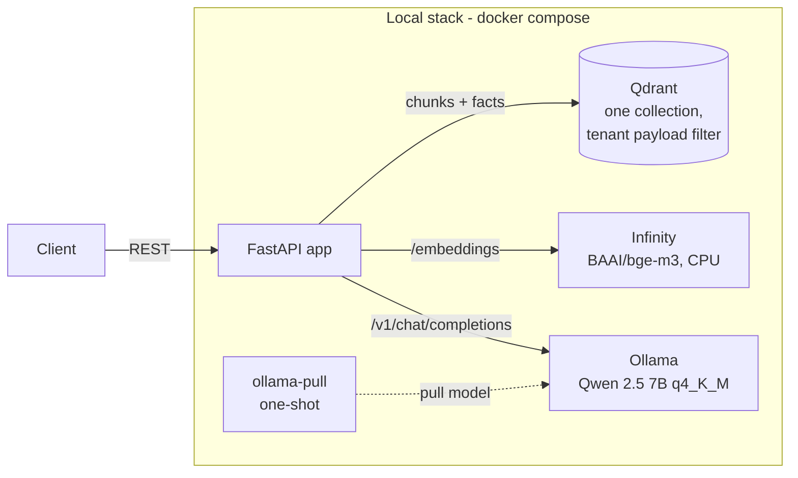
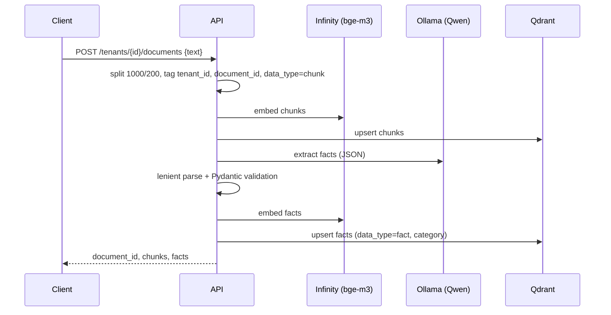

# CreatorAI local RAG ("Brand Brain")

A self-hosted retrieval-augmented generation pipeline that runs entirely on
open-source models: **Qwen 2.5 via Ollama** for extraction and drafting,
**BAAI/bge-m3 via Infinity** for embeddings, **Qdrant** for vectors.
No external API keys, no data leaves the machine.

This repository is a cleaned-up, standalone extract of the RAG part of
**CreatorAI**, a private SaaS for content creators (Instagram experts and
coaches) that I designed and run in production on a single CPU-only VPS. The
product code (auth, billing, admin, UI) stays private; this repo keeps the part
that is interesting on its own: turning a creator's transcripts, notes and chats
into a per-tenant knowledge base that local models can use.

## What it does

1. **Ingest** any text (video transcript, article, notes, chat log) for a tenant.
2. **Chunk and embed** it (1000/200 recursive splitter -> bge-m3 -> Qdrant).
3. **Extract facts** with a local LLM: 5-30 short, standalone, categorised
   facts (`target_audience`, `tone_of_voice`, `products`, `goals`, ...).
   These facts are the creator's "Brand Brain" - memory that every later chat
   can reuse.
4. **Answer** a question: semantic search over the tenant's chunks and facts,
   plus an optional category pass ("this prompt always needs tone of voice and
   audience"), merge and de-duplicate, then draft the answer with the local
   model.

## Architecture



Ingest path:



Ask path: `POST /tenants/{id}/ask` -> semantic top-k (tenant filter) + category
top-k (tenant + `data_type=fact` + categories) -> merge/dedupe -> optional
compression -> Qwen drafts the answer -> answer + sources.

| File | Role |
|---|---|
| `app/config.py` | All settings from env (`.env.example`) |
| `app/llm.py` | One OpenAI-compatible client for any local server |
| `app/vector_store.py` | Qdrant collection, payload indexes, Infinity embeddings |
| `app/ingest.py` | Chunking, fact documents, per-document delete |
| `app/extractor.py` | Fact extraction prompt, lenient JSON parsing |
| `app/retriever.py` | Tenant filter, two-pass retrieval, dedupe |
| `app/answer.py` | Context formatting, optional compression, answer |
| `app/main.py` | FastAPI endpoints |

## Models

| Role | Model | Served by | Why |
|---|---|---|---|
| Embeddings | `BAAI/bge-m3` (1024-d, dense) | Infinity, CPU | Multilingual (the product works in Ukrainian, Russian and English), 8k context, good quality on CPU |
| Extraction / drafts | `qwen2.5:7b-instruct-q4_K_M` | Ollama | Fits in ~5 GB RAM, usable on 4 CPU cores, decent JSON and Cyrillic |
| Also tried | `qwen3.5:9b` | Ollama behind an OpenAI-compatible gateway | Better reasoning, too slow on CPU for interactive use |

Because the client speaks the OpenAI chat API, the LLM can be swapped without
code changes: Ollama, llama.cpp `llama-server`, LM Studio, or `mlx_lm.server`
on Apple Silicon (set `LLM_BASE_URL` / `LLM_MODEL`).

## Run it

Requirements: Docker with Compose v2, ~12 GB free disk, 8+ GB RAM for the
7B model (use a 3B model on smaller machines).

```bash
cp .env.example .env          # optional, defaults work
docker compose up -d --build  # first start downloads ~7 GB of models
docker compose ps             # wait until api is running
python scripts/demo.py        # ingest the fictional demo notes and ask two questions
```

API docs: http://localhost:8000/docs. Qdrant dashboard: http://localhost:6333/dashboard.

```bash
curl -X POST localhost:8000/tenants/demo/documents \
  -H 'Content-Type: application/json' \
  -d '{"text": "My audience is busy parents who want 20-minute home workouts...", "source": "notes"}'

curl -X POST localhost:8000/tenants/demo/ask \
  -H 'Content-Type: application/json' \
  -d '{"question": "Suggest 3 reel ideas", "required_categories": ["target_audience"]}'
```

Faster on a laptop: `LLM_MODEL=qwen2.5:3b-instruct docker compose up -d --build`.
On a Mac, run Ollama natively (Metal GPU) and point the API at it with
`LLM_BASE_URL=http://host.docker.internal:11434/v1`.

Unit tests (no models needed):

```bash
pip install -r requirements-dev.txt
pytest
```

## Design decisions

- **Everything local, OpenAI-compatible interfaces.** Infinity and Ollama both
  speak the OpenAI API, so LangChain's `OpenAIEmbeddings` / `ChatOpenAI` work
  against them and the runtime is replaceable. In production the LLM provider
  is switchable from the admin panel at runtime (local Qwen or a hosted model)
  through the same interface.
- **Facts, not only chunks.** Raw chunks answer "what did I say in that video";
  extracted facts answer "who is my audience" across dozens of sources. Facts are
  short, categorised and cheap to put into a prompt.
- **One collection, tenant payload filter.** All tenants share one Qdrant
  collection; every search and delete goes through `tenant_filter()`, which
  refuses an empty tenant id. Keyword payload indexes on `tenant_id`,
  `data_type`, `category`, `document_id` keep filtered search fast. Deleting a
  document removes its chunks and the facts extracted from it.
- **Two-pass retrieval.** Pure semantic search misses context the question does
  not mention ("write hooks" does not look like "tone of voice"), so prompts can
  declare required fact categories that are always fetched.
- **Big k, then trim.** k=50 facts is fine: facts are one or two sentences, and
  a large context of short facts worked better than a few long chunks.
- **Lenient parsing for small models.** 7B models wrap JSON in chatter or
  invent categories; the parser extracts the JSON object, validates each item
  with Pydantic, maps unknown categories to `other` and drops broken items
  instead of failing the whole document.
- **Safe defaults for inference containers.** Pinned image digests,
  `no-new-privileges`, dropped capabilities, CPU/RAM limits, bounded logs, ports
  bound to 127.0.0.1 only. In production the inference containers sit on a
  private network shared by several products and are reachable only through a
  read-only reverse-proxy gateway per consumer.
- **Embedding model changes are additive.** Stored vectors depend on the model,
  so a new embedding model means a new collection and re-indexing, never an
  in-place swap.

## What didn't work (honest notes)

- **Local 7-9B models in live dialogs.** Qwen 2.5 7B and Qwen 3.5 9B on CPU were
  not good enough for live, multi-turn conversations with end users (and, in a
  sibling project, live sales dialogs): slow first token, weaker instruction
  following over long prompts, drifting tone and language. They were kept for
  background jobs where quality is checked and latency does not matter: fact
  extraction, summaries, drafts. For live chat the product switches (from the
  admin panel) to a hosted model that gets the same RAG context.
- **Compressing context with the local model.** The first version sent 30 facts
  through Qwen to compress them into a 300-word brief before every chat answer.
  On a CPU-only VPS that added tens of seconds per message and caused proxy
  timeouts on streamed responses. It was removed from the hot path; the code is
  kept behind `COMPRESS_CONTEXT=false`, and the raw facts go straight into the
  prompt instead.
- **Embedding server churn.** Infinity hung on startup on a small VPS; swapping
  to HuggingFace TEI and then to Infinity's ONNX CPU image (which crash-looped)
  did not help. The fix was boring: more CPU/RAM, back to the standard Infinity
  image, a 10-minute health-check start period for the first model download, and
  `check_embedding_ctx_length=False` so LangChain sends strings, not token ids.
- **Managed vector DB first.** The project started on Pinecone and moved to
  self-hosted Qdrant + Infinity so client content stays on our own server and
  there is one less external service.

## How it was built

Built AI-native. I (the author) own the product, requirements, architecture,
data model, prompts and acceptance; the code was written by coding agents
(Claude Code and OpenAI Codex), and changes go through review - by me and by an
independent AI reviewer that did not write the code - before merge. This showcase was extracted
from the private product the same way.

## Not included

Auth, billing, admin panel, prompt library, frontend, Celery workers, Whisper
transcription and the deployment scripts of the product. The demo data in
`examples/` is fictional.

## License

MIT
